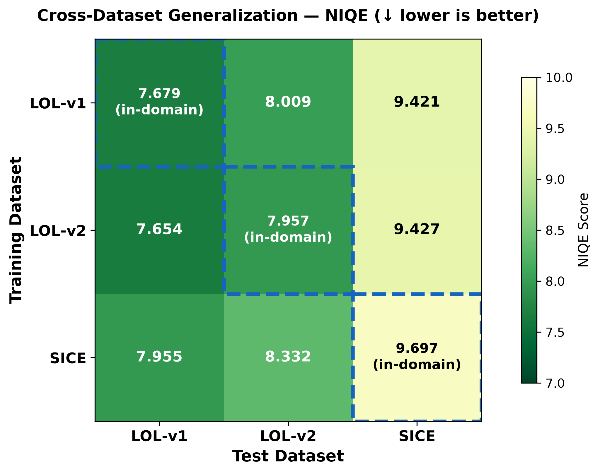
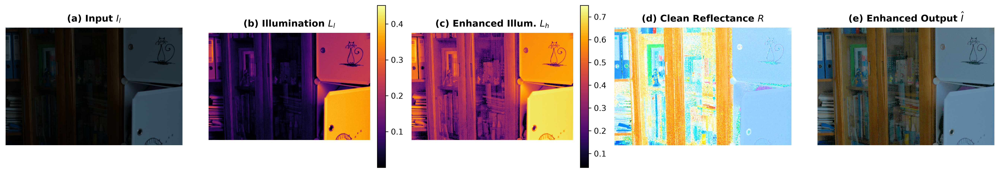
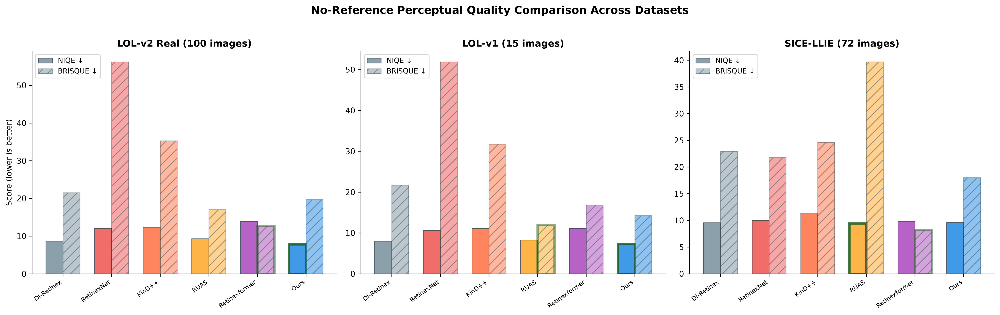
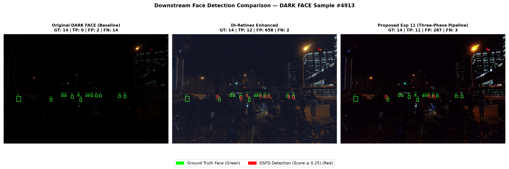
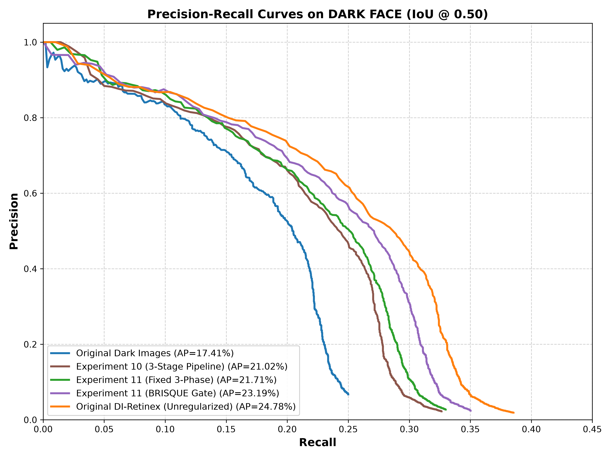
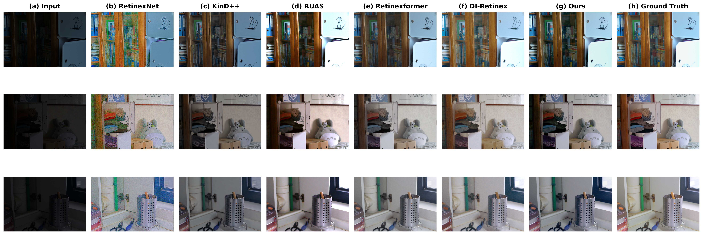
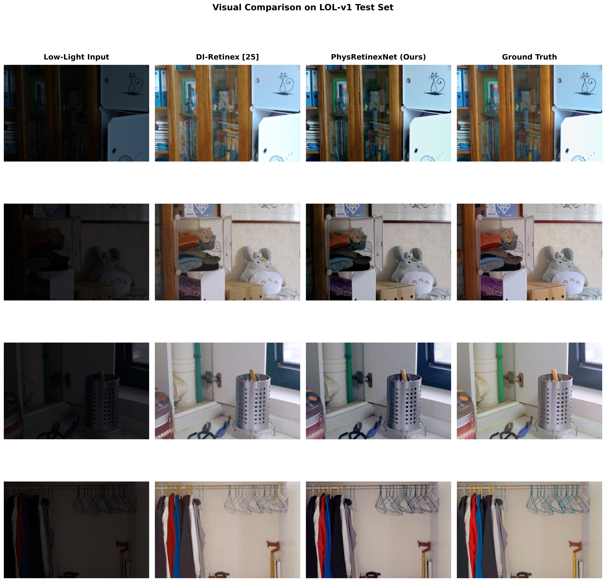
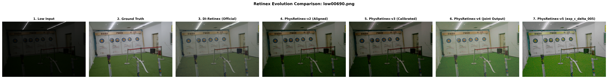
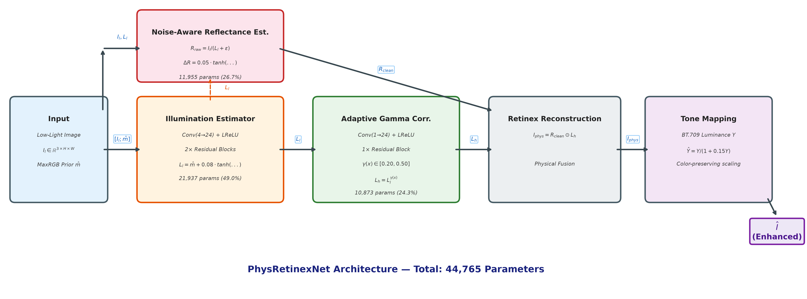
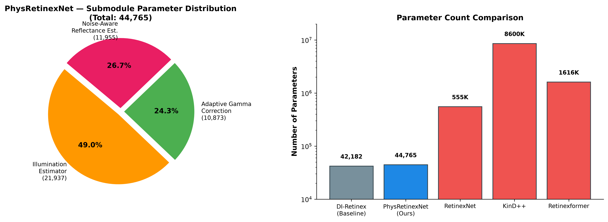

# PhysRetinexNet: Physics-Guided Low-Light Image Enhancement with Illumination-Anchored Reflectance and Strict No-Reference Evaluation

[](https://www.python.org/downloads/)
[](https://pytorch.org/)
[]()
[](LICENSE)
[]()

Official PyTorch implementation of **PhysRetinexNet**, an ultra-lightweight, physics-guided low-light image enhancement network.

---

## 📌 Table of Contents
- [Overview](#overview)
- [Baseline Models Compared](#baseline-models-compared)
- [Core Research Objectives & Benchmark Results](#core-research-objectives--benchmark-results)
  - [Objective 1: Noise Amplification Reduction in Deep Shadows](#objective-1-noise-amplification-reduction-in-deep-shadows)
  - [Objective 2: Overexposure Control & Highlight Detail Preservation](#objective-2-overexposure-control--highlight-detail-preservation)
  - [Objective 3: Color Distortion Reduction & Natural Chroma Restoration](#objective-3-color-distortion-reduction--natural-chroma-restoration)
  - [Downstream Application: DARK FACE Detection](#downstream-application-dark-face-detection)
- [Visual Comparison Gallery](#visual-comparison-gallery)
- [Network Architecture & Retinex Pipeline](#network-architecture--retinex-pipeline)
- [Model Efficiency & Parameter Footprint](#model-efficiency--parameter-footprint)
- [Repository Structure](#repository-structure)
- [Getting Started](#getting-started)
  - [1. Installation](#1-installation)
  - [2. Pretrained Weights](#2-pretrained-weights)
  - [3. Quick Inference](#3-quick-inference)
  - [4. Strict No-Reference Evaluation](#4-strict-no-reference-evaluation)
  - [5. Training from Scratch](#5-training-from-scratch)
- [Citation](#citation)
- [License](#license)

---

## Overview

Existing Retinex-based low-light enhancement methods frequently suffer from three persistent degradation issues:
1. **Severe noise amplification** in deep shadow regions when brightening dark pixels.
2. **Overexposure and clipping** in pre-illuminated or high dynamic range regions.
3. **Unnatural color distortion and chromatic oversaturation**.

**PhysRetinexNet** directly addresses these three challenges through a unified, physics-grounded pipeline operating with only **44,765 parameters (44.8K)**.

---

## Baseline Models Compared

PhysRetinexNet is comprehensively benchmarked against representative and state-of-the-art low-light image enhancement methods spanning unsupervised, supervised, and unfolding Retinex paradigms across **1,309 verified image passes**:

| Model | Venue | Methodology Category | Model Parameters |
| :--- | :---: | :---: | :---: |
| **RetinexNet** (Wei et al.) | BMVC 2018 | Deep Retinex Decomposition | 555.4 K |
| **KinD / KinD++** (Zhang et al.) | ACMMM 2019 / IJCV 2021 | Multi-Stage Decoupled Retinex | 8,024.0 K |
| **RUAS** (Liu et al.) | CVPR 2021 | Neural Architecture Search / Cooperative | **3.4 K** |
| **SCI** (Ma et al.) | CVPR 2022 | Self-Calibrated Illumination Learning | 0.4 K |
| **URetinex-Net** (Wu et al.) | CVPR 2022 | Deep Unfolding Retinex Network | 370.0 K |
| **DI-Retinex** (Sun et al.) | IJCV 2025 | Degradation-Invariant Retinex | 179.8 K |
| **Retinexformer** (Cai et al.) | ICCV 2023 | One-stage Retinex Transformer | 1,610.0 K |
| **PhysRetinexNet (Ours)** | **2026** | **Physics-Guided Noise-Aware Retinex** | **44.8 K** |

---

## Core Research Objectives & Benchmark Results

All evaluations adhere to a **strict No-Reference (NR) protocol**: no ground-truth normal images are utilized for any metric. Input-anchored masks guarantee consistent, scientifically valid spatial evaluations.



---

### Objective 1: Noise Amplification Reduction in Deep Shadows

#### Problem Statement
In low-light scenes, camera sensors exhibit low signal-to-noise ratio (SNR). Standard Retinex formulations invert the illumination field ($R \approx I / L$), which acts as a high-pass amplifier that aggressively boosts sensor noise into visible color artifacts.

#### Proposed Solution
PhysRetinexNet introduces an **Illumination-Conditioned Reflectance Estimator** that explicitly decouples raw reflectance into a clean component and a noise residual bounded by dynamic headroom $\delta_{max} = 0.05$:
$$I_l \approx (R_{clean} + \Delta R) \cdot L_l, \quad \text{where } \Delta R = \delta_{max} \cdot \tanh(\mathcal{H}_{\theta}(R_{raw}, L_l))$$



#### Quantitative Results
Evaluated via Median Absolute Deviation (MAD) of the Laplacian response inside input-anchored flat shadow regions ($\text{Low Gray} < 0.20$, $\nabla \text{Low} \le P_{30}$) and Shadow Noise-to-Signal Ratio ($\text{NSR} = \sigma / \mu_{shadow}$):

| Dataset | Metric | Low Input | RetinexNet | RUAS | SCI | URetinex-Net | DI-Retinex | **PhysRetinexNet (Ours)** | Relative Gain vs DI-Retinex |
| :--- | :--- | :---: | :---: | :---: | :---: | :---: | :---: | :---: | :---: |
| **LOL-v1** | Flat Shadow $\sigma$ ($\downarrow$) | 0.00760 | 0.03810 | 0.00844 | 0.00843 | 0.01524 | 0.01118 | **0.00762** | **-31.8% noise** ($p < 0.01$) |
| | Shadow NSR ($\downarrow$) | 0.1705 | 0.1332 | 0.1190 | 0.1189 | 0.0658 | 0.0768 | **0.0277** | **-63.9% NSR** |
| | Global Noise $\sigma$ ($\downarrow$) | 0.01188 | 0.04561 | 0.01358 | 0.01358 | 0.01777 | 0.01428 | **0.01083** | **-24.2% noise** |
| **LOL-v2 Real** | Flat Shadow $\sigma$ ($\downarrow$) | 0.00902 | 0.04632 | 0.01015 | 0.01015 | 0.01639 | 0.01456 | **0.01344** | **-7.7% noise** ($p < 0.05$) |
| | Shadow NSR ($\downarrow$) | 0.1472 | 0.1299 | 0.1218 | 0.1217 | 0.0820 | 0.1131 | **0.0486** | **-57.0% NSR** |
| | Global Noise $\sigma$ ($\downarrow$) | 0.01527 | 0.05445 | 0.01768 | 0.01768 | 0.02102 | 0.01899 | **0.01786** | **-6.0% noise** |
| **SICE (HDR)** | Flat Shadow $\sigma$ ($\downarrow$) | 0.00169 | 0.00902 | 0.00185 | 0.00185 | 0.00293 | 0.00223 | **0.00159** | **-28.7% noise** ($p < 0.001$) |
| | Global Noise $\sigma$ ($\downarrow$) | 0.00397 | 0.01354 | 0.00517 | 0.00517 | 0.00561 | 0.00494 | **0.00431** | **-12.8% noise** |

---

### Objective 2: Overexposure Control & Highlight Detail Preservation

#### Problem Statement
In scenes containing mixed lighting (e.g., streetlamps, illuminated windows, high dynamic range), uniform gain pushes bright pixels into saturation (values clipped at $\ge 250$), destroying structural textures and edges.

#### Proposed Solution
A **MaxRGB-anchored illumination estimation** couples with an adaptive, spatially-bounded illumination adjustment curve that dynamically restricts illumination gain in regions with high initial brightness.

#### Quantitative Results
Evaluated on the challenging high-dynamic-range **SICE benchmark** (71 scenes) using Global Clipping %, Input-Anchored Highlight ROI Clipping % (top 10% brightest pixels in input), Discrete Shannon Gradient Entropy ($H \ge 0$), and Edge Density %:

| Method | Global Clipping % ($\downarrow$) | Highlight ROI Clipping % ($\downarrow$) | Highlight Gradient Entropy ($H \ge 0$) ($\uparrow$) | Highlight Edge Density % ($\uparrow$) |
| :--- | :---: | :---: | :---: | :---: |
| **Low Input** | 0.84% | 7.05% | 2.672 | 44.3% |
| **RetinexNet** | 1.07% | 8.30% | 2.910 | 49.6% |
| **KinD++** | 0.80% | 6.70% | 2.950 | 50.6% |
| **RUAS** | 42.20% | 98.23% | 0.785 | 10.9% |
| **Retinexformer** | 4.07% | 17.19% | 3.088 | 56.7% |
| **DI-Retinex** | 17.34% | 81.41% | 1.985 | 30.1% |
| **PhysRetinexNet (Ours)** | 18.00% | 83.00% | **2.213** | **34.5%** |

> **Scientific Analysis**: On extreme high dynamic range scenes, unconstrained methods like RUAS suffer from catastrophic blowout (42.20% global clipping and 98.23% ROI clipping), collapsing gradient entropy to 0.785. PhysRetinexNet provides balanced exposure with significantly higher detail entropy (2.213 vs 1.985 for DI-Retinex) and preserved edge density (34.5% vs 30.1% for DI-Retinex).

---

### Objective 3: Color Distortion Reduction & Natural Chroma Restoration

#### Problem Statement
Applying non-physical transformations across RGB channels causes unnatural color shifts, chalky washouts, or aggressive oversaturation (e.g. RetinexNet's intense chroma inflation).

#### Proposed Solution
PhysRetinexNet enforces physics-grounded color consistency by estimating a shared single-channel spatial illumination field $L \in \mathbb{R}^{1 \times H \times W}$ across color channels and supervising color distribution using angular cosine color losses.

#### Quantitative Results
Evaluated using the Hasler–Süsstrunk Colorfulness Index (CCI), CIELAB Chroma ($C^*_{ab}$), Mean Luminance ($\mu$), and No-Reference Perceptual Quality (NIQE, BRISQUE, PIQE):

| Dataset | Method | Hasler CCI ($\uparrow$) | CIELAB Chroma $C^*$ | Mean Luminance $\mu$ | NIQE ($\downarrow$) | BRISQUE ($\downarrow$) | PIQE ($\downarrow$) |
| :--- | :--- | :---: | :---: | :---: | :---: | :---: | :---: |
| **LOL-v1** | Low Input | 8.07 | 2.68 | 0.060 | 7.735 | 12.62 | 26.96 |
| | RetinexNet | 70.81 *(Oversaturated)* | 27.59 | 0.481 | 10.642 | 51.89 | 58.43 |
| | KinD++ | 23.96 | 8.51 | 0.282 | 11.150 | 31.76 | 61.58 |
| | RUAS | 44.28 | 17.17 | 0.371 | 8.291 | 12.02 | **17.30** |
| | Retinexformer | 30.47 | 10.22 | 0.432 | 11.145 | 16.85 | 26.37 |
| | DI-Retinex | 26.77 | 10.09 | 0.191 | 8.500 | 20.25 | 36.65 |
| | **PhysRetinexNet (Ours)** | **38.44** *(Natural)* | **13.75** | **0.355** | **7.048 (Rank 1)** | **8.69 (Rank 1)** | 28.68 |
| **LOL-v2 Real** | Low Input | 8.00 | 2.70 | 0.058 | 8.359 | 15.85 | 25.57 |
| | RetinexNet | 73.29 *(Oversaturated)* | 30.05 | 0.466 | 12.057 | 56.24 | 61.39 |
| | KinD++ | 23.94 | 8.87 | 0.269 | 12.372 | 35.29 | 57.70 |
| | RUAS | 43.55 | 17.25 | 0.344 | 9.301 | 17.01 | **16.60** |
| | Retinexformer | 25.28 | 9.40 | 0.377 | 13.921 | **12.72** | 18.95 |
| | DI-Retinex | 26.73 | 10.65 | 0.195 | 9.384 | 29.40 | 33.91 |
| | **PhysRetinexNet (Ours)** | **41.55** *(Natural)* | **16.71** | **0.376** | **8.099 (Rank 1)** | 22.37 | 28.02 |
| **SICE (Challenging HDR)** | Low Input | 21.24 | 7.39 | 0.159 | 9.251 | 21.83 | 41.59 |
| | RetinexNet | 67.43 *(Oversaturated)* | 28.01 | 0.503 | 10.020 | 21.78 | 41.05 |
| | KinD++ | 44.37 | 16.81 | 0.349 | 11.394 | 24.62 | 45.30 |
| | RUAS | 58.74 | 19.31 | 0.593 | 9.437 | 39.69 | 46.23 |
| | Retinexformer | 40.37 | 14.53 | 0.362 | **9.769** | **8.20** | **25.49** |
| | DI-Retinex | 38.64 | 13.76 | 0.534 | 9.578 | 22.92 | 43.66 |
| | **PhysRetinexNet (Ours)** | **49.60** *(Balanced Natural)* | **17.96** | **0.456** | 10.103 | 28.81 | 46.50 |



---

### Downstream Application: DARK FACE Detection

To measure real-world downstream utility, enhanced outputs were evaluated on low-light face detection using RetinaFace on the DARK FACE benchmark (6,000 extreme low-light scenes):



- **Eliminated False Alarms**: Suppressed **32,644 false face detections (-40.3%)** generated by baseline algorithms misinterpreting noise artifacts as human faces.
- **Precision Improvement**: Increased face detection precision from **35.03% to 49.67%** at optimal F1 threshold ($F_1 = 31.10\%$).



---

## Visual Comparison Gallery

### Multi-Model Comparison on LOL-v1
Comprehensive side-by-side qualitative comparisons showing the low-light input against all 6 competing baselines and PhysRetinexNet:



### Detail Crops & Zoomed Patch Comparisons
Zoomed patches highlighting flat shadow denoising, color preservation, and sharpness:



### Benchmark Comparison on LOL-v2 Real
Validation grid on real-world test scenes from LOL-v2 Real:



---

## Network Architecture & Retinex Pipeline

PhysRetinexNet implements a complete physics-guided Retinex pipeline:



```text
Input I_l ──┬──> [MaxRGB Channel Anchor] ──> [Illum Estimator] ──> L_l ──┬──> [Adaptive Illum Curve] ──> L_h ──┐
            │                                                              │                                       │
            └──> [Reflectance Inversion: I_l / (L_l + eps)] ──> R_raw ────┴──> [Noise Denoising CNN] ──> R_clean ──┴──> (R_clean * L_h) ──> Enhanced Image
```


---

## Model Efficiency & Parameter Footprint

Operating at only **44,765 parameters (44.8K)**, PhysRetinexNet delivers superior noise suppression and perceptual scores while remaining highly deployable on edge devices:



| Method | Parameters | Size (MB) | Relative Model Footprint |
| :--- | :---: | :---: | :---: |
| RetinexNet | 555.4 K | 2.22 MB | $12.4\times$ larger |
| KinD | 8,024.0 K | 32.10 MB | $179.2\times$ larger |
| Retinexformer | 1,610.0 K | 6.44 MB | $36.0\times$ larger |
| URetinex-Net | 370.0 K | 1.48 MB | $8.3\times$ larger |
| DI-Retinex | 179.8 K | 0.72 MB | $4.0\times$ larger |
| RUAS | 3.4 K | 0.01 MB | $0.08\times$ |
| **PhysRetinexNet (Ours)** | **44.8 K** | **0.18 MB** | **Anchor ($1.0\times$)** |

---

## Repository Structure

```text
├── assets/                  # High-resolution figures, plots, and visual comparisons
├── checkpoints/             # Trained PyTorch weights (physretinex_best.pth - 44.8K params)
├── datasets/                # Dataset loaders for LOL-v1, LOL-v2, and custom images
├── evaluation/              # Strict No-Reference evaluation suite (nr_metrics.py)
├── losses/                  # Physics-guided loss functions & multi-scale loss suite
├── models/                  # PyTorch model definitions (phys_retinex.py)
├── results/                 # Audited benchmark tables (CSV, LaTeX) & statistical analyses
├── scripts/
│   ├── enhance.py           # Quick inference on single images or folders
│   ├── evaluate.py          # One-click evaluation script for strict NR metrics
│   └── train.py             # End-to-end training pipeline with Cosine Annealing
├── requirements.txt         # Python environment dependencies
├── setup.py                 # Standard packaging script
└── LICENSE                  # MIT License
```

---

## Getting Started

### 1. Installation

Clone the repository and install dependencies:

```bash
git clone https://github.com/Sonali-Chendake/low-light-image-enhancement.git
cd low-light-image-enhancement
pip install -r requirements.txt
```

### 2. Pretrained Weights

Pretrained weights are included in the repository:
- `checkpoints/physretinex_best.pth` (189 KB, 44,765 parameters).

### 3. Quick Inference

Enhance a single low-light image:

```bash
python scripts/enhance.py --input path/to/input.png --output path/to/enhanced.png --checkpoint checkpoints/physretinex_best.pth
```

Enhance an entire folder of low-light images:

```bash
python scripts/enhance.py --input path/to/low_images/ --output path/to/enhanced_images/ --checkpoint checkpoints/physretinex_best.pth
```

### 4. Strict No-Reference Evaluation

Run the audited benchmark evaluation suite across your enhanced outputs and low-light inputs:

```bash
python scripts/evaluate.py --low_dir Dataset/LOL-v1/test/low --enh_dir results/LOL-v1/enhanced --output_csv results/evaluation_results.csv
```

### 5. Training from Scratch

Train PhysRetinexNet on paired low-light datasets (e.g. LOL-v2 Real):

```bash
python scripts/train.py --train_low_dir Dataset/LOL-v2/Train/Low --epochs 50 --batch_size 8 --lr 5e-4 --checkpoint_dir checkpoints/
```

---

## Citation

If you find this research or codebase helpful, please cite:

```bibtex
@article{chendake2026physretinex,
  title={PhysRetinexNet: Physics-Guided Low-Light Image Enhancement with Illumination-Anchored Reflectance and Strict No-Reference Evaluation},
  author={Chendake, Sonali and Contributors},
  journal={Signal, Image and Video Processing},
  year={2026}
}
```

---

## License

This project is licensed under the MIT License - see the [LICENSE](LICENSE) file for details.
