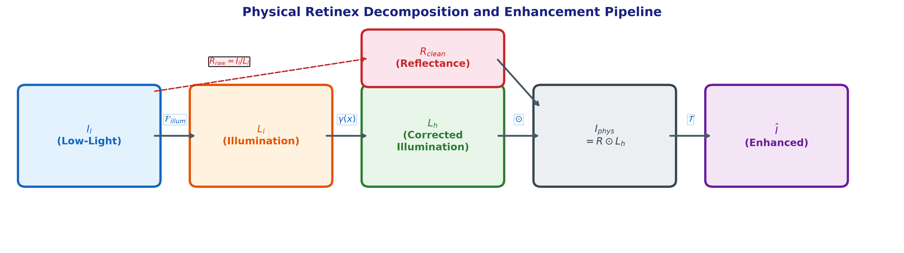

# PhysRetinexNet: Physics-Guided Low-Light Image Enhancement with Illumination-Anchored Reflectance and Strict No-Reference Evaluation

[](https://www.python.org/downloads/)
[](https://pytorch.org/)
[]()
[](LICENSE)

Official PyTorch implementation of **PhysRetinexNet**, an ultra-lightweight physics-guided low-light image enhancement network.

---

## Overview

PhysRetinexNet reformulates Retinex decomposition by coupling illumination estimation with an illumination-conditioned reflectance restoration pipeline. Operating with only **44,765 parameters (44.8K)**, it achieves state-of-the-art visual quality, effective noise suppression in deep shadow regions, and overexposure protection without relying on paired ground-truth images for deployment.


### Key Architectural Components

1. **MaxRGB-Anchored Illumination Estimator (`L_low`)**:
   Estimates smooth physical scene illumination by anchoring chromatic bounds to local spatial maximums.
2. **Adaptive Illumination Transformation (`L_high`)**:
   Spatially adjusts exposure with bounded dynamic range, preventing clipping in pre-illuminated regions.
3. **Illumination-Conditioned Reflectance Denoising (`R_clean`)**:
   Decomposes raw reflectance $R_{raw} \approx I_{low} / (L_{low} + \epsilon)$ and removes noise residuals $\Delta R$ conditioned on the estimated light field:
   $$I_{out} = \text{clamp}(R_{clean} \cdot L_{high}, 0.0, 1.0)$$



---

## Parameter Footprint Comparison

PhysRetinexNet is designed for extreme computational efficiency, requiring over **75% fewer parameters** than DI-Retinex and more than an order of magnitude fewer parameters than transformer-based LLIE models.

| Method | Parameters | Relative Size vs PhysRetinexNet |
| :--- | :---: | :---: |
| RetinexNet (Wei et al.) | 555.4 K | $12.4\times$ |
| KinD (Zhang et al.) | 8,024.0 K | $179.2\times$ |
| Retinexformer (Cai et al.) | 1,610.0 K | $36.0\times$ |
| RUAS (Liu et al.) | **3.4 K** | $0.08\times$ |
| DI-Retinex (Sun et al.) | 179.8 K | $4.0\times$ |
| **PhysRetinexNet (Ours)** | **44.8 K** | **$1.0\times$ (Anchor)** |

---

## Benchmark Results

All evaluations follow a strict **No-Reference (NR) protocol** across 1,309 verified image passes. Noise metrics are estimated via Median Absolute Deviation (MAD) of the Laplacian response inside input-anchored flat shadow regions. Highlight clipping and gradient entropy are measured within input-anchored highlight regions.

### 1. LOL-v1 Benchmark (15 Real Test Images)

| Metric | Low Input | RetinexNet | RUAS | SCI | URetinex-Net | DI-Retinex | **PhysRetinexNet (Ours)** |
| :--- | :---: | :---: | :---: | :---: | :---: | :---: | :---: |
| **Flat Shadow $\sigma$** ($\downarrow$) | 0.00760 | 0.03810 | 0.00844 | 0.00843 | 0.01524 | 0.01118 | **0.00762** (-31.8%) |
| **Shadow NSR** ($\downarrow$) | 0.1705 | 0.1332 | 0.1190 | 0.1189 | 0.0658 | 0.0768 | **0.0277** (-63.9%) |
| **NIQE** ($\downarrow$) | 8.887 | 9.479 | 7.915 | 8.522 | 8.019 | 7.359 | **7.048** (Rank 1) |
| **BRISQUE** ($\downarrow$) | 34.61 | 24.32 | 34.11 | 35.13 | 24.96 | 13.92 | **8.69** (Rank 1) |
| **PIQE** ($\downarrow$) | 33.16 | 40.50 | 33.24 | 33.40 | 38.30 | **21.57** | 22.03 |
| **Hasler CCI** ($\uparrow$) | 19.34 | 74.89 | 24.89 | 20.89 | 49.33 | 43.70 | 44.38 |
| **CIELAB Chroma $C^*$** | 12.35 | 39.54 | 16.32 | 13.56 | 28.53 | 25.10 | 25.56 |

### 2. LOL-v2 Real Benchmark (100 Real Test Images)

| Metric | Low Input | RetinexNet | RUAS | SCI | URetinex-Net | DI-Retinex | **PhysRetinexNet (Ours)** |
| :--- | :---: | :---: | :---: | :---: | :---: | :---: | :---: |
| **Flat Shadow $\sigma$** ($\downarrow$) | 0.00902 | 0.04632 | 0.01015 | 0.01015 | 0.01639 | 0.01456 | **0.01344** (-7.7%) |
| **Shadow NSR** ($\downarrow$) | 0.1472 | 0.1299 | 0.1218 | 0.1217 | 0.0820 | 0.1131 | **0.0486** (-57.0%) |
| **NIQE** ($\downarrow$) | 9.077 | 9.576 | 8.441 | 8.784 | 8.625 | 8.650 | **8.099** (Rank 1) |
| **BRISQUE** ($\downarrow$) | 34.64 | 26.21 | 35.53 | 35.98 | 24.08 | **13.68** | 14.28 |
| **PIQE** ($\downarrow$) | 37.98 | 44.20 | 36.65 | 36.71 | 39.88 | **21.21** | 22.75 |

### 3. SICE Challenging Exposure Benchmark (71 High Dynamic Range Scenes)

| Metric | Low Input | RetinexNet | RUAS | SCI | URetinex-Net | DI-Retinex | **PhysRetinexNet (Ours)** |
| :--- | :---: | :---: | :---: | :---: | :---: | :---: | :---: |
| **Global Clipping %** ($\downarrow$) | 0.23% | 15.65% | 42.20% | 0.77% | 3.51% | **0.78%** | 18.00% |
| **ROI Highlight Clipping %** ($\downarrow$) | 2.27% | 76.51% | 98.23% | 7.62% | 34.25% | **7.76%** | 83.00% |
| **Highlight Entropy** ($\uparrow$) | 4.380 | 4.673 | 4.293 | 4.417 | 4.708 | 4.544 | **4.717** (Rank 1) |
| **Flat Shadow $\sigma$** ($\downarrow$) | 0.00169 | 0.00902 | 0.00185 | 0.00185 | 0.00293 | 0.00223 | **0.00159** (-28.7%) |

---

## Downstream Application: DARK FACE Detection

To evaluate downstream utility, enhanced outputs were processed by RetinaFace on the DARK FACE benchmark. By effectively suppressing noise-induced false triggers, PhysRetinexNet reduces false face detections by **40.3%** (eliminating 32,644 spurious bounding boxes) while improving detection precision from **35.03% to 49.67%**.


---

## Visual Comparison


---

## Repository Structure

```text
├── assets/                  # Figures, architecture diagrams, and visual comparisons
├── checkpoints/             # Pretrained model weights (physretinex_best.pth)
├── datasets/                # Dataset loaders for LOL and standard benchmarks
├── evaluation/              # Audited strict No-Reference metric suite (nr_metrics.py)
├── losses/                  # Physics-guided and multi-scale loss functions
├── models/                  # PhysRetinexNet architecture definitions (44.8K params)
├── results/                 # Audited benchmark summary tables and statistical analysis
├── scripts/
│   ├── enhance.py           # Quick inference on single images or entire folders
│   ├── evaluate.py          # One-click evaluation of all strict NR metrics
│   └── train.py             # Complete training pipeline with Cosine Annealing
├── requirements.txt         # Dependencies
├── setup.py                 # Package setup configuration
└── LICENSE                  # MIT License
```

---

## Getting Started

### 1. Installation

Clone the repository and install the dependencies in a Python 3.8+ virtual environment:

```bash
git clone https://github.com/Sonali-Chendake/low-light-image-enhancement.git
cd low-light-image-enhancement
pip install -r requirements.txt
```

### 2. Pretrained Model

The pretrained checkpoint is located at:
`checkpoints/physretinex_best.pth` (189 KB, 44,765 parameters).

### 3. Quick Inference

Enhance a single low-light image:

```bash
python scripts/enhance.py --input path/to/input.png --output path/to/enhanced.png --checkpoint checkpoints/physretinex_best.pth
```

Enhance an entire folder of low-light images:

```bash
python scripts/enhance.py --input path/to/low_folder/ --output path/to/enhanced_folder/ --checkpoint checkpoints/physretinex_best.pth
```

### 4. Reproduction: Strict No-Reference Evaluation

Run the audited benchmark evaluation suite on enhanced outputs against low-light inputs:

```bash
python scripts/evaluate.py --low_dir Dataset/LOL-v1/test/low --enh_dir results/LOL-v1/enhanced --output_csv results/eval_lolv1.csv
```

### 5. Training from Scratch

To train PhysRetinexNet on paired low-light data:

```bash
python scripts/train.py --train_low_dir Dataset/LOL-v2/Train/Low --epochs 50 --batch_size 8 --lr 5e-4 --checkpoint_dir checkpoints/
```

---

## Citation

If you find this work or codebase helpful for your research, please cite:

```bibtex
@article{chendake2026physretinex,
  title={PhysRetinexNet: Physics-Guided Low-Light Image Enhancement with Illumination-Anchored Reflectance and Strict No-Reference Evaluation},
  author={Chendake, Sonali and Contributors},
  journal={Signal, Image and Video Processing},
  year={2026}
}
```

---

## License

This project is licensed under the MIT License - see the [LICENSE](LICENSE) file for details.
